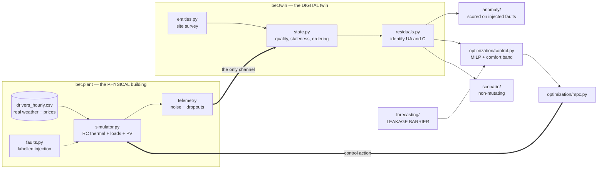

# Building Energy Digital Twin

A stateful digital twin of a commercial office: it ingests telemetry, estimates
its own thermal parameters from that telemetry, forecasts, detects faults,
simulates scenarios, and controls HVAC and a battery through a comfort-constrained
MPC loop built with [Pyomo](https://www.pyomo.org/).

**The building is simulated.** The "physical" plant is
[`src/bet/plant/simulator.py`](src/bet/plant/simulator.py). The weather it
responds to and the prices it pays are real — PVGIS satellite irradiance and
ERA5 temperature for Berlin 2019, DE/LU day-ahead prices — but no real building
exists behind this, and nothing here should be read as a measurement of one.

> Built incrementally, phase by phase. `PROJECT_BRIEF.md` is the scope agreed
> before any code was written; [`docs/decisions.md`](docs/decisions.md) records
> every decision taken after it, **including the two places where measurement
> contradicted the plan.**

## Twin, shadow, or model?

The brief asks for this distinction to be drawn explicitly, and drawing it
honestly matters more than claiming the strongest label.

| | Data flow | Here |
|---|---|---|
| Digital **Model** | manual, nothing automatic | no |
| Digital **Shadow** | automatic physical → digital | more than this |
| Digital **Twin** | automatic in both directions | **structurally, yes** |

The loop genuinely closes: the controller's actions are applied to the plant,
which advances and emits the next telemetry, which updates the twin. That is a
twin's architecture. What it is not is a twin *of anything real*.

The wall that makes this worth doing at all: **nothing in `bet.twin` imports
`bet.plant`**, and an AST test enforces it. The twin sees only noisy,
occasionally-missing sensor readings. A twin that reads the simulator's
internals is measuring itself.

## What it does

Over a 78-day test window, against the thermostat already in the building:

| Controller | EUR | Save | HVAC MWh | Energy | Peak kW | Comfort violations |
|---|---:|---:|---:|---:|---:|---:|
| thermostat | 5,868 | — | 21.81 | — | 337 | 8 |
| thermostat + greedy battery | 5,864 | 0.1% | 21.81 | +0.0% | 337 | 8 |
| **MPC, cost** | **5,440** | **7.3%** | 26.24 | **+20.3%** | 400 | **0** |
| MPC, cost + energy | 5,435 | 7.4% | 24.87 | +14.0% | 364 | 0 |
| MPC, cost + peak | 5,668 | 3.4% | 27.46 | +25.9% | **220** | 0 |

**Cost-optimal is not energy-optimal.** The cost-minimising controller is 7.3%
cheaper while burning 20.3% *more* HVAC electricity: pre-heating and pre-cooling
widen temperature excursions, and wider excursions lose more heat through the
envelope. Reporting only the saving would mislead exactly the person most likely
to read it, so a `cost_energy` objective ships alongside and both numbers appear
together everywhere.

## Two things the measurements said that the plan did not

Both are recorded rather than quietly folded in, because a corrected prediction
is more useful than one that was never tested.

### The battery does the work, not the walls

This project was planned around the fabric being the primary storage asset:
across its 3 K comfort band the building holds 750 kWh-thermal, about 250
kWh-electric at COP 3, matching the battery's nameplate exactly.

| Scenario | Saving | % |
|---|---:|---:|
| baseline | 428 EUR | 7.30% |
| **no battery** | **57 EUR** | **0.98%** |
| battery doubled | 720 EUR | 12.27% |
| comfort band ±1 K | 469 EUR | 8.26% |

Roughly **87% of the value is the battery, 13% the walls.** Equal stored energy,
very unequal usable flexibility — energy parked in the fabric can only move
inside the comfort band, and moving it *raises* envelope losses. A battery loses
only its round trip.

The one lever that improves cost *and* consumption together is a wider comfort
band: ±1 K is worth 469 EUR and cuts HVAC energy from 26.2 to 20.5 MWh.

### A wrong model controlled the building better

The twin identifies its own thermal parameters from telemetry, and gets them
wrong in a specific way:

| Parameter | True | Identified | Error |
|---|---:|---:|---:|
| UA | 5.00 kW/K | 5.83 kW/K | +17% |
| Capacitance | 250 kWh/K | 357 kWh/K | **+43%** |
| Time constant | 50 h | 61 h | +22% |

Running the MPC against the plant's **true** parameters saves marginally more
(7.9% vs 7.3%) and violates comfort **269 times**. Against the biased identified
model it violates comfort **zero** times. The mechanism, verified rather than
assumed: the true-model controller correctly rides the 24 °C cooling bound
(median occupied temperature 24.46 °C) and unmodelled load variability pushes it
up to 0.73 K over. The identified model thinks the building is more sluggish
than it is, keeps a margin, and sits at 23.42 °C.

**Its inaccuracy accidentally buys robustness, at 0.6% more cost.**

The bias itself is not a defect to apologise for. It is what closed-loop
identification does: the training data comes from a building under thermostat
control, so HVAC power is itself a *response* to the temperature error the
regression is explaining. Fitting only on HVAC-idle intervals removes that
correlation and is measurably worse — UA collapses to 0.06 kW/K.

## Fault detection, scored rather than demonstrated

Five faults injected at known times, so detection can be measured: precision,
recall, detection latency, **and false-alarm rate on clean data** — the last
usually omitted and the one that decides whether a detector survives a month in
service.

The finding that mattered: all three residual-based detectors scored **zero
recall on a stuck temperature sensor**, and not through bad tuning. The twin
predicts the next temperature from the previous *measured* one, so when the
sensor freezes both sides of the residual freeze together and the residual is
only as large as the hourly change the model expected. An entire family of
methods is blind to that fault by construction.

A flatline detector — watching for an *absence* of variation rather than a large
residual — catches it at **0.944 recall, 4 hour latency**.

Also exposed rather than hidden: a drifting meter and a decayed heat pump
produce the *same* signature in the HVAC residual. Separating them needs a second
independent measurement, which is why `Fault.kind` distinguishes physical from
sensor faults throughout.

## Architecture



The two heavy arrows are the loop. Everything the twin knows arrives through
telemetry; everything it does leaves as a control action. There is no third path,
and the test suite proves it.

## Install and run

```bash
pip install -e ".[dev,solvers,viz]"
```

[HiGHS](https://highs.dev/) arrives with the `solvers` extra and is the only
solver needed — no conda, no Ipopt.

```bash
python -m bet.plant.calibration        # building vs published benchmarks
python -m bet.forecasting.evaluate     # forecast model selection
python -m bet.anomaly.scoring          # fault detection scores
python -m bet.scenario.engine          # the nine what-if scenarios
streamlit run app/streamlit_app.py     # dashboard
```

The dataset is committed, so a clone runs offline. To regenerate it:

```bash
python data/download_weather.py && python data/download_prices.py && python data/prepare_dataset.py
```

## The reference building

7,500 m² office, single thermal zone, 250 kWp rooftop PV, 250 kWh battery, a
reversible heat pump, weekday 07:00–19:00 occupancy. Every parameter is checked
against published office benchmarks by `bet.plant.calibration`, and CI fails if
any drifts outside:

| Quantity | Measured | Plausible range |
|---|---:|---|
| Electricity intensity | 104.7 kWh/m²/yr | 70–250 |
| Peak demand | 44.8 W/m² | 20–80 |
| HVAC share | 20.3% | 15–55 |
| Thermal time constant | 50 h | 10–150 |
| PV yield | 1,094 kWh/kWp/yr | 800–1,300 |

## Tests

```bash
pytest -v
```

55 tests, ~26 seconds, entirely on synthetic driver windows — no network, no
130 MB download.

Three of them check that a safeguard can *fail* rather than that it passes: the
leakage check catches a deliberately inserted leak, the MILP test asserts its own
LP relaxation misbehaves, and an AST test walks `bet/twin/` to prove nothing
there imports `bet.plant`. A test that cannot fail produces confidence rather
than information.

## Limitations

The ones that would change a real decision:

- **The building is simulated.** Everything above is a claim about
  `plant/simulator.py`, not about any building.
- **Single zone.** One capacitance cannot represent a south face baking while a
  north face freezes.
- **No free cooling.** No window opening, night purge or economizer, so the only
  heat rejection is mechanical. Free-running temperature reaches 58 °C in summer,
  which is the model being self-consistent (315 kW of gains against 5 kW/K
  settles 63 K above outdoor) rather than broken. Every reported result uses
  mechanical cooling.
- **Constant COP.** A real heat pump loses efficiency exactly when it is needed
  most.
- **Daily demand charge proxy**, where a real one is monthly.
- **Point forecasts only**, so the controller cannot be made risk-aware.

Full detail in [`docs/decisions.md`](docs/decisions.md).

## Companion repos

Six standalone optimization models built to the same conventions — validated
dataclasses that fail loudly at construction, a builder that never touches raw
files, and a result dataclass rather than a live model — but sharing no code.

- [economic-dispatch-pyomo](https://github.com/Ahmadmohammadip/economic-dispatch-pyomo)
  — multi-period, multi-bus DC-OPF with ramping, curtailable renewables and LMPs.
- [battery-storage-optimization-pyomo](https://github.com/Ahmadmohammadip/battery-storage-optimization-pyomo)
  — wholesale arbitrage co-optimized with frequency regulation as a single LP.
- [cvrp-optimization-pyomo](https://github.com/Ahmadmohammadip/cvrp-optimization-pyomo)
  — exact MILP for the Capacitated Vehicle Routing Problem, with a measured
  benchmark of where exact methods stop scaling.
- [supply-chain-network-optimization-pyomo](https://github.com/Ahmadmohammadip/supply-chain-network-optimization-pyomo)
  — multi-echelon network design and production-distribution planning as one MILP.
- [forecast-driven-bess-dispatch](https://github.com/Ahmadmohammadip/forecast-driven-bess-dispatch)
  — ML forecasts driving a behind-the-meter battery, measuring what the forecast
  is worth. **The closest sibling to this repo**: there the state is a battery's
  charge and the hard part is predicting price; here the state is a building's
  temperature and the hard part is identifying the physics.

## License

MIT — see `LICENSE`. That covers the code only, not the data; see
[`data/ATTRIBUTION.md`](data/ATTRIBUTION.md).
